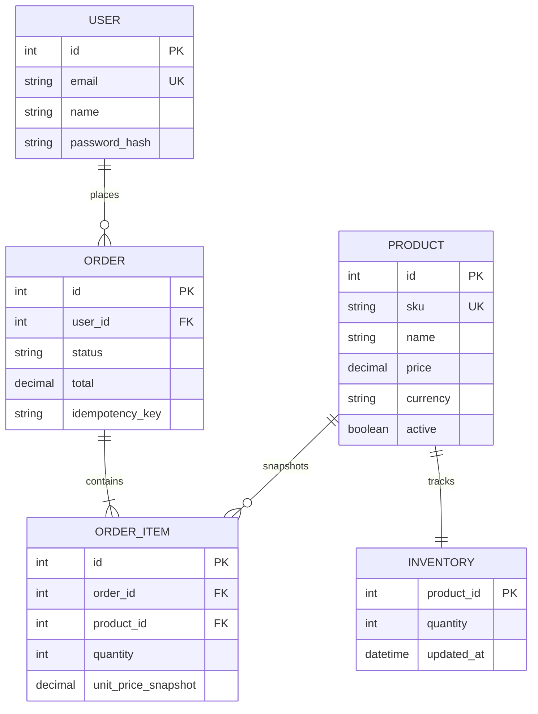

# Week 1: E-commerce API Requirements and Design

## Summary

The first-week deliverable is an API design, not an e-commerce implementation. The machine-readable contract is [OpenAPI 3.1](../openapi/ecommerce.yaml), suitable for rendering in Swagger UI, Redoc, or the Swagger Editor. This specification establishes customer, product, inventory, and order resources, consistent JSON envelopes, authentication boundaries, validation rules, and error responses. The subsequent assignment changes to a blog API; that distinct implementation is documented in [Weeks 2–5](week-2-to-5-implementation.md).

## Scope and assumptions

- Customers can register, authenticate, read/update their own profile, browse active products, and manage their own orders.
- Staff users administer products and inventory. Staff authorization comes from verified server-side identity claims, not client-supplied role headers.
- Products have a unique SKU, category, active/archive state, currency, and decimal-string price. Money must not use binary floating-point arithmetic.
- Inventory is keyed by product. The public endpoint exposes sellable availability, while stock adjustments are audited and staff-only.
- Checkout accepts multiple product/quantity lines and a shipping address. Prices and totals are calculated by the server from current catalog data.
- Orders are treated as business records, so delete is not exposed as a normal CRUD operation. Cancellation is a state transition; order history and line snapshots remain.
- Payment-provider integration, tax, shipping quotations, refunds, and multi-warehouse inventory are out of scope for this initial design.

## Functional requirements

1. Register an account with a unique email, name, and strong password; never return password material.
2. Authenticate and issue short-lived bearer access tokens; allow the current user to read, update, and delete their profile.
3. Browse, search, filter, and paginate active products. Staff can create, edit, and archive products.
4. Read public availability and allow authorized, audited stock adjustments.
5. Create an order from one or more valid product lines, reserve stock atomically, snapshot item names/SKUs/prices, and calculate totals server-side.
6. List and read only the caller's orders unless staff access is established. Permit cancellation only before fulfillment and restore reserved quantity exactly once.
7. Return stable machine-readable errors, validate request bodies and query/path parameters, and reject unauthorized or cross-user operations.

## Non-functional requirements

- HTTPS in all deployed environments; passwords stored using a modern adaptive password hash (Argon2id preferred; scrypt/bcrypt accepted when configured securely).
- Apply authentication, authorization, input validation, request-size limits, rate limits on authentication and checkout, and security headers.
- Use parameterized SQL or an ORM, foreign keys, unique constraints, and database transactions for order placement/cancellation and inventory changes.
- Use idempotency keys for order creation. Use cursor pagination for stable product/order listing at scale.
- Log request IDs and operational events without logging passwords, tokens, or full payment/address secrets. Define retention and privacy policy.
- Return timestamps in ISO 8601 UTC and monetary amounts as decimal strings with an ISO 4217 currency code.

## Resource relationships



## Checkout sequence

```mermaid
sequenceDiagram
  actor Customer
  participant API
  participant Auth as Auth middleware
  participant DB as Relational database
  Customer->>API: POST /orders + bearer token + Idempotency-Key
  API->>Auth: Verify signature, expiry, user status and role
  Auth-->>API: Authenticated customer identity
  API->>API: Validate lines/address and normalize request
  API->>DB: Begin transaction; check idempotency key
  API->>DB: Lock/check products and available inventory
  alt All lines valid and stock available
    API->>DB: Snapshot prices, create order/lines, reserve stock
    API->>DB: Commit transaction and store idempotency result
    API-->>Customer: 201 order resource
  else Out of stock or invalid product
    API->>DB: Roll back transaction
    API-->>Customer: 409 conflict (no partial order)
  end
```

## Endpoint specification

The OpenAPI file is authoritative for schemas and response bodies. The table below summarizes every operation and the expected status behavior.

| Method and path | Auth | Inputs | Success | Main errors |
| --- | --- | --- | --- | --- |
| `POST /auth/register` | Public | JSON `name`, `email`, `password` | `201` user and token | `400`, `409` |
| `POST /auth/login` | Public | JSON `email`, `password` | `200` user and token | `400`, `401` |
| `GET /users/me` | Customer | Bearer token | `200` profile | `401` |
| `PATCH /users/me` | Customer | JSON `name` and/or `email` | `200` profile | `400`, `401`, `409` |
| `DELETE /users/me` | Customer | Bearer token | `204` | `401` |
| `GET /products` | Public | Optional `q`, `category`, `limit` (1–100), `cursor` | `200` page | `400` |
| `POST /products` | Staff | Product JSON: name, description, SKU, price, currency, category | `201` product | `400`, `401`, `403`, `409` |
| `GET /products/{productId}` | Public | Positive integer path ID | `200` product | `404` |
| `PATCH /products/{productId}` | Staff | At least one product field | `200` product | `400`, `401`, `403`, `404`, `409` |
| `DELETE /products/{productId}` | Staff | Positive integer path ID | `204` archived | `401`, `403`, `404` |
| `GET /products/{productId}/inventory` | Public | Positive integer product ID | `200` public availability | `404` |
| `PUT /products/{productId}/inventory` | Staff | Integer quantity and adjustment reason | `200` availability | `400`, `401`, `403`, `404` |
| `GET /orders` | Customer | Optional `limit`, `cursor` | `200` own order page | `401` |
| `POST /orders` | Customer | `Idempotency-Key`; lines and shipping address | `201` order | `400`, `401`, `409` |
| `GET /orders/{orderId}` | Customer/staff | Positive integer order ID | `200` authorized order | `401`, `403`, `404` |
| `PATCH /orders/{orderId}` | Owner/staff | `status: cancelled` | `200` cancelled order | `400`, `401`, `403`, `404`, `409` |

## Response and error contract

Successful single-resource responses use `{ "data": { ... } }`; collections use `{ "data": [...], "page": { "nextCursor": null, "hasMore": false } }`. Errors use `{ "error": { "code": "VALIDATION_ERROR", "message": "...", "details": [] } }`.

| HTTP | Meaning | Example codes |
| --- | --- | --- |
| `400` | Malformed JSON, invalid field, or invalid query/path parameter | `VALIDATION_ERROR`, `INVALID_JSON` |
| `401` | Missing, invalid, or expired credentials | `UNAUTHORIZED`, `INVALID_CREDENTIALS` |
| `403` | Identity is valid but access is not allowed | `FORBIDDEN` |
| `404` | Resource is absent or not visible to caller | `NOT_FOUND` |
| `409` | Uniqueness, stock, idempotency, or state conflict | `CONFLICT`, `INSUFFICIENT_STOCK` |
| `429` | Rate limit exceeded | `RATE_LIMITED` |
| `500` | Unexpected server failure; no internals exposed | `INTERNAL_ERROR` |

## Security and validation decisions

Validate at the API boundary and enforce critical invariants again in the database. Reject unknown or malformed IDs, oversized bodies, invalid emails/currencies, negative quantities, and blank or overlong strings. Parameterize all queries. Never trust a user ID, price, order total, role, or stock level supplied by the client. Check ownership on every order/profile operation. Staff routes need an explicit role check after signature verification. Avoid revealing whether an email exists during login. Rate-limit login/register/checkout, use short-lived tokens, support revocation/rotation, and redact secrets from logs. Checkout and cancellation must be transactional and idempotent to prevent overselling or duplicate stock release.

## Backend implementation roadmap

1. Confirm domain rules, data retention, currency/rounding, and role policy with stakeholders.
2. Create migrations and constraints for users, products, inventory, orders, order items, idempotency records, and audit events.
3. Add identity registration/login, password hashing, token lifecycle, and role/ownership middleware.
4. Implement product reads and staff CRUD; add pagination, search indexes, and validation.
5. Implement inventory adjustments and transactional order placement/cancellation with concurrency tests.
6. Add OpenAPI validation, integration tests, structured logs, rate limiting, and metrics.
7. Deploy through CI/CD with secrets management, migrations, rollback strategy, health checks, and staging smoke tests.

## Approach summary

The design uses resource-oriented paths and standard HTTP semantics, with OpenAPI 3.1 as the contract. It keeps public catalog discovery separate from privileged administration, models orders as durable business records rather than freely deletable rows, and treats inventory reservation as a transactional operation. The diagrams make resource ownership and checkout data flow reviewable before implementation. This is intentionally a planning artifact: the implemented code in this repository is the separate blog platform requested by Weeks 2–5.