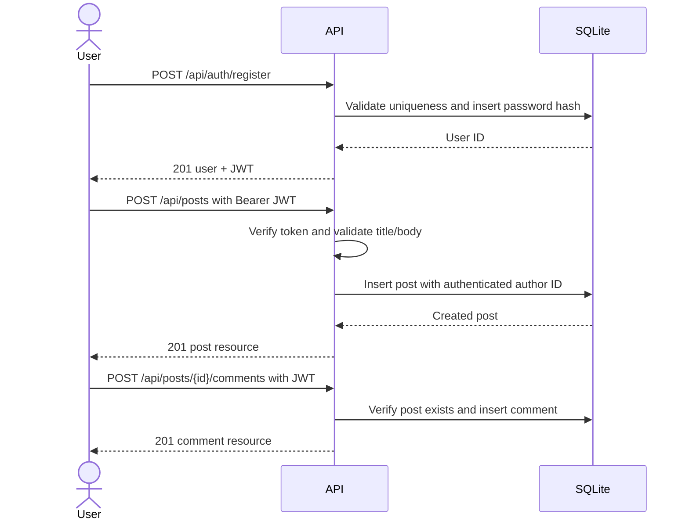

# Weeks 2–5: Blog API Implementation Report

## Project summary

The later assignment describes a blog platform, so this implementation is separate from the Week 1 e-commerce contract. It provides registration and login, authenticated user identity, post CRUD, comment creation/read/update/delete, SQLite persistence, ownership checks, validation, and stable JSON errors. The test suite exercises workflows across authentication and persistence, while the GitHub Actions workflow runs the suite on pushes and pull requests.

## Requirements and design

- Users register with a name, email, and password. Passwords are stored as salted scrypt hashes and are never included in response objects.
- Authentication uses signed, one-hour JWT bearer tokens. Public reads are allowed for posts/comments; writes require authentication.
- Only a post or comment author may update/delete that resource. Foreign keys cascade dependent comments when a post is deleted.
- Inputs have explicit maximum lengths, blank values are rejected, email format is checked, and request JSON is limited to 32 KB.
- Post lists are bounded to 100 rows per page and use limit/offset metadata. SQL statements use placeholders.
- Common errors have HTTP status and stable `error.code` values; unexpected errors do not expose stack details to clients.

## API reference

| Method and path | Authentication | Request | Success |
| --- | --- | --- | --- |
| `POST /api/auth/register` | None | `{ "name", "email", "password" }` | `201 { data: { user, token } }` |
| `POST /api/auth/login` | None | `{ "email", "password" }` | `200 { data: { user, token } }` |
| `GET /api/auth/me` | Bearer token | None | `200 { data: user }` |
| `GET /api/posts?limit=20&offset=0` | None | Optional pagination query | `200 { data: posts, meta }` |
| `POST /api/posts` | Bearer token | `{ "title", "body" }` | `201 { data: post }` |
| `GET /api/posts/{postId}` | None | Positive integer path ID | `200 { data: post }` |
| `PATCH /api/posts/{postId}` | Bearer, author only | Partial `title` and/or `body` | `200 { data: post }` |
| `DELETE /api/posts/{postId}` | Bearer, author only | Positive integer path ID | `204` |
| `GET /api/posts/{postId}/comments` | None | Positive integer post ID | `200 { data: comments }` |
| `POST /api/posts/{postId}/comments` | Bearer token | `{ "body" }` | `201 { data: comment }` |
| `PATCH /api/comments/{commentId}` | Bearer, author only | `{ "body" }` | `200 { data: comment }` |
| `DELETE /api/comments/{commentId}` | Bearer, author only | Positive integer comment ID | `204` |
| `GET /health` | None | None | `200 { "status": "ok" }` |

### Example flow



## Error behavior

| Status | Example code | Meaning |
| --- | --- | --- |
| `400` | `VALIDATION_ERROR`, `INVALID_ID`, `INVALID_JSON` | Invalid request body or identifier |
| `401` | `UNAUTHORIZED`, `INVALID_CREDENTIALS` | Missing/invalid token or credentials |
| `403` | `FORBIDDEN` | The authenticated user does not own the resource |
| `404` | `NOT_FOUND` | Route or resource does not exist |
| `409` | `EMAIL_EXISTS` | Registration email is already in use |
| `500` | `INTERNAL_ERROR` | Unexpected failure, details kept server-side |

## Week 3: Debugging and verification record

This repository is a clean implementation of the stated behavior rather than the provided intentionally buggy project (no source buggy project was included in the assignment text). The test suite is designed to catch common backend regressions: duplicate registration, invalid inputs reaching persistence, password leakage, unauthenticated writes, cross-user mutation, missing foreign-key cascades, and broken create/read/update/delete flows. The checks are reproducible with `npm test`; test results should be recorded after execution in the target environment.

| Risk/bug class | Resolution in this project | Verification |
| --- | --- | --- |
| Plaintext passwords or password fields in API output | Salted scrypt hash; explicit safe user projection | Registration/login tests and password-field assertion |
| Duplicate account race/constraint error | Case-insensitive unique email and explicit `409` mapping | Duplicate registration test |
| Broken authentication or arbitrary author assignment | Verify JWT and derive author ID from authenticated user | Auth-required and cross-user tests |
| SQL injection through IDs or input | Prepared statements; strict integer ID parser | CRUD and invalid-ID tests |
| Orphan comments after post deletion | SQLite foreign keys with cascade delete | Cascade test |
| Inconsistent errors on malformed input | Validation and JSON parser error handlers | Validation and malformed JSON tests |

## Week 4: Performance measurement plan

Use the benchmark script against the local API after creating a representative set of posts. Keep the environment and dataset fixed for before/after comparisons. It issues configurable concurrent `GET /api/posts` requests and reports request count, throughput, error count, and p50/p95/p99 latency. Save the JSON output for the baseline and each optimization using `RESULT_FILE`. No measured values are included because the environment's Node runtime is unavailable here and performance data must not be fabricated.

The list endpoint uses a narrow joined query, a bounded page size, and indexes for ordering/author access. The next controlled optimization candidates are cursor pagination, a matching composite index based on `EXPLAIN QUERY PLAN`, avoiding a full count on every request, and caching only if freshness requirements permit it. Compare each change with the same warmup, duration, request mix, machine, and database fixture; report latency percentiles and throughput, not only averages.

## Week 5: Integration tests and CI simulation

`test/api.test.js` runs end-to-end HTTP requests through Express and a fresh in-memory SQLite database. It covers registration, login, bearer authentication, post CRUD, comment CRUD, ownership authorization, validation, and cascades. `.github/workflows/ci.yml` checks out the repository, installs Node 20 dependencies, and runs `npm test` for pushes and pull requests. The workflow demonstrates automated verification only; it does not deploy to a public service or require production secrets.

## Run and test

```sh
npm install
npm start
npm test
```

For deployment, set `JWT_SECRET` to a unique secret of at least 32 characters and configure `DATABASE_PATH` to a durable writable location. Production hardening still needed includes a secrets manager, TLS termination, rate limiting, refresh/revocation policy, backup/restore drills, and deployment/migration rollback procedures.